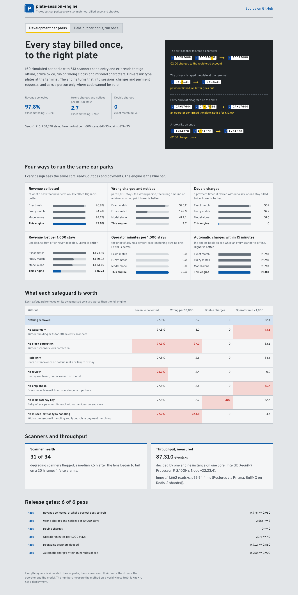
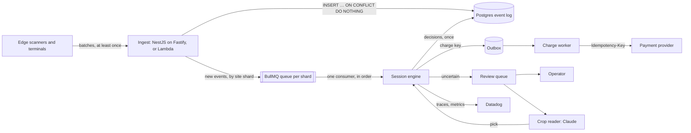
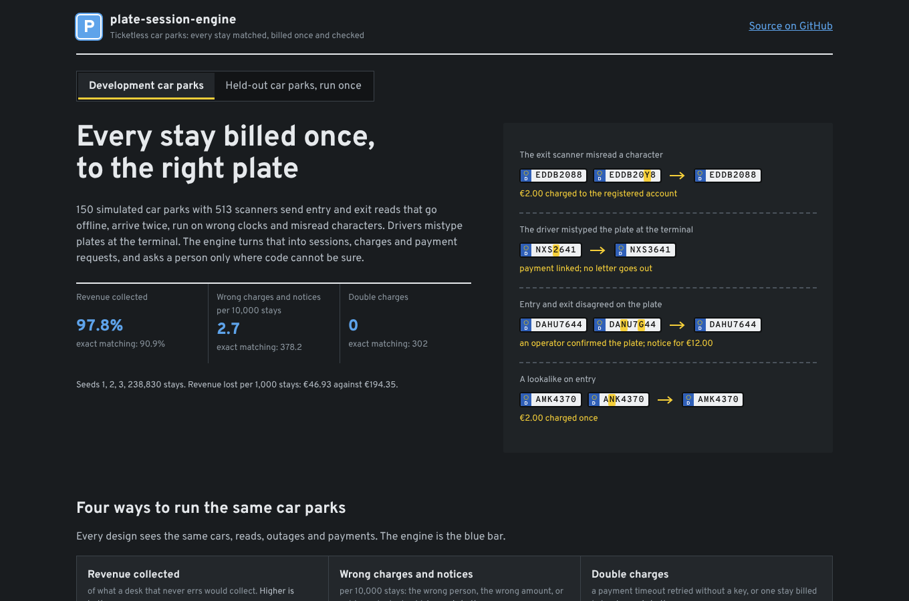
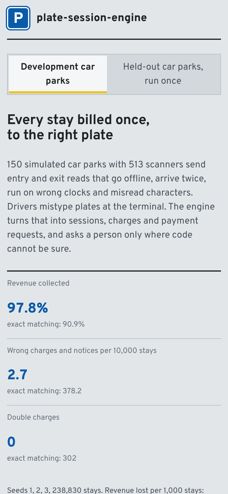

# plate-session-engine

A ticketless car park bills a stay by joining two licence-plate reads: one at the entry, one at the exit. That
join is where the money is made or lost. A misread character, a scanner that was offline, a duplicate read, a
clock running ten minutes fast or a driver who mistypes the plate at the terminal each turns into a stay nobody
bills, a driver charged twice, or a payment letter to someone who had paid.

This engine joins reads into sessions as weighed evidence and decides as much as code can be sure of. It holds an
exit while an entry scanner is still sending its backlog, corrects scanner clocks, and charges through an outbox
with idempotency keys. It sends a payment notice only for a plate it is certain of, and puts the rest in front of a
person. A vision model compares camera crops first, and code checks its answer. It also watches every scanner and
raises a ticket when its reads start to degrade.

Everything is measured in simulated car parks whose truth is known: 150 sites, 513 scanners, about 80,000 stays a
seed. The baselines are exact plate matching, fuzzy matching, and a model deciding alone, all on the same luck. A
held-out world (Austrian plates, December, more outages) ran once, after the code was frozen.



## Results

<!-- results:start -->

_Generated from `reports/*.json` by `pnpm readme`; do not edit by hand._

**Development world** (seeds 1, 2, 3; per seed 150 sites, 513 scanners, two days; 238,830 stays and 1,611,077 events in all, about 11,188 an hour per seed)

| Design | Revenue collected, of what a perfect desk collects | Revenue lost per 1,000 stays | Wrong charges and notices per 10,000 stays | Notices to drivers who had paid | Double charges | Operator minutes per 1,000 stays | Automatic charges within 15 min of exit |
|---|---:|---:|---:|---:|---:|---:|---:|
| Exact plate match, one session per plate, notice when no payment, retry on timeout | 90.9% | €194 | 378.2 | 7,195 | 302 | 0.0 | 98.9% |
| Plus fuzzy matching: nearest plate one edit away, accepted without review | 94.4% | €120 | 149.0 | 1,367 | 327 | 0.0 | 98.9% |
| Plus a vision model that picks the entry for every unmatched exit, unchecked | 94.7% | €114 | 422.1 | 7,351 | 320 | 0.0 | 98.9% |
| **plate-session-engine** | 97.8% | €47 | 2.7 | 17 | 0 | 32.4 | 96.0% |

Against exact matching the engine collects €33,317 more over the 3 simulated two-day runs, sends 8,488 fewer wrong charges and notices, and no double charge. Scanner health: 31 of 34 degrading scanners flagged (median 7.5 h after the lens began to fail, on a 20 h ramp), 4 false alarms.

**Each safeguard removed on its own** (development world)

| Design | Revenue collected, of what a perfect desk collects | Revenue lost per 1,000 stays | Wrong charges and notices per 10,000 stays | Notices to drivers who had paid | Double charges | Operator minutes per 1,000 stays | Automatic charges within 15 min of exit |
|---|---:|---:|---:|---:|---:|---:|---:|
| **plate-session-engine** | 97.8% | €47 | 2.7 | 17 | 0 | 32.4 | 96.0% |
| Without holding exits for offline entry scanners | 97.8% | €48 | 3.0 | 18 | 0 | 43.1 | 97.7% |
| Without scanner clock correction | 97.3% | €59 | 27.2 | 18 | 0 | 33.1 | 95.8% |
| Plate distance only, no colour, make or length of stay | 97.8% | €47 | 2.6 | 16 | 0 | 34.6 | 96.0% |
| Best guess taken, no review and no model | 95.7% | €92 | 2.4 | 20 | 0 | 0.0 | 97.0% |
| Every uncertain exit to an operator, no crop check | 97.8% | €47 | 2.6 | 17 | 0 | 41.4 | 96.0% |
| Retry after a payment timeout without an idempotency key | 97.8% | €47 | 2.7 | 17 | 303 | 32.4 | 96.0% |
| Without missed-exit handling and typed-plate payment matching | 97.2% | €60 | 344.8 | 7,537 | 0 | 4.4 | 96.7% |

Release gates: 6 of 6 pass.

| Gate | Value | Limit | |
|---|---:|---:|---|
| Revenue collected, of what a perfect desk collects | 0.978 | >= 0.960 | pass |
| Wrong charges and notices per 10,000 stays | 2.655 | <= 3 | pass |
| Double charges | 0 | <= 0 | pass |
| Operator minutes per 1,000 stays | 32.409 | <= 40 | pass |
| Degrading scanners flagged | 0.912 | >= 0.850 | pass |
| Automatic charges within 15 minutes of exit | 0.960 | >= 0.900 | pass |

**Held-out world, run once** (seeds 101, 102; Austrian plates, winter, more airports, more scanners offline and for longer, more misreads and typos; config 4941c1a388df9a10)

| Design | Revenue collected, of what a perfect desk collects | Revenue lost per 1,000 stays | Wrong charges and notices per 10,000 stays | Notices to drivers who had paid | Double charges | Operator minutes per 1,000 stays | Automatic charges within 15 min of exit |
|---|---:|---:|---:|---:|---:|---:|---:|
| Exact plate match, one session per plate, notice when no payment, retry on timeout | 87.3% | €262 | 497.6 | 5,662 | 161 | 0.0 | 98.7% |
| Plus fuzzy matching: nearest plate one edit away, accepted without review | 91.6% | €172 | 202.5 | 1,069 | 183 | 0.0 | 98.8% |
| Plus a vision model that picks the entry for every unmatched exit, unchecked | 92.1% | €163 | 582.5 | 5,830 | 181 | 0.0 | 98.7% |
| **plate-session-engine** | 96.1% | €81 | 2.0 | 7 | 0 | 42.6 | 95.2% |

Scanner health: 22 of 27 degrading scanners flagged (median 8.7 h after the lens began to fail, on a 20 h ramp), 16 false alarms.

Release gates: 4 of 6 pass.

| Gate | Value | Limit | |
|---|---:|---:|---|
| Revenue collected, of what a perfect desk collects | 0.961 | >= 0.960 | pass |
| Wrong charges and notices per 10,000 stays | 2.047 | <= 3 | pass |
| Double charges | 0 | <= 0 | pass |
| Operator minutes per 1,000 stays | 42.574 | <= 40 | **fail** |
| Degrading scanners flagged | 0.815 | >= 0.850 | **fail** |
| Automatic charges within 15 minutes of exit | 0.952 | >= 0.900 | pass |

Throughput, measured (not simulated) on Intel(R) Xeon(R) Processor @ 2.10GHz, Node v22.23.4: the engine decides 87,310 events a second on one core.
The NestJS ingest endpoint takes 11,662 reads a second, p99 94.4 ms (Postgres via Prisma, BullMQ on Redis, 2 shard(s)).

<!-- results:end -->

## How a stay is decided



1. **Deduplicate.** Reads from one scanner within 2.2 s are the same car, unless their plates are too far apart;
   up to 6 s, if the plates are close. An event delivered twice is ignored.
2. **Wait for the evidence.** An exit is decided once every entry scanner on its site has reported past it, and a
   reconnected scanner has had time to flush its backlog. Clocks are corrected from heartbeats.
3. **Weigh the candidates.** Every open entry within reach of the exit's plate (lookalike characters are cheap)
   is scored as a likelihood ratio: plate, colour, make and length of stay. Above 97% the engine decides.
4. **Ask where unsure, if it pays.** The crop reader looks first; its pick is taken only if the engine's own
   evidence makes it plausible. Otherwise an operator decides, with the pick as a suggestion. A review is opened
   only when the fee it can recover is worth the operator's minutes.
5. **Bill once.** Registered drivers are charged through the outbox with an idempotency key. Others are matched
   to their terminal or app payment, including mistyped plates whose amount fits the stay. A notice goes out only
   for a certain plate.
6. **Watch the scanners.** A CUSUM on low-confidence reads flags a lens going bad; a missing heartbeat flags an
   outage. An entry open far longer than the site's stays is checked for a missed exit.

## Run it

```bash
pnpm install
pnpm --filter @pse/store generate       # Prisma client
pnpm test                               # every package; set PSE_TEST_DATABASE_URL / PSE_TEST_REDIS_URL for Postgres and BullMQ
pnpm study && pnpm readme               # the dev study (about 4 minutes) and this README's results
pnpm api                                # the API on :3000, in memory; or: docker compose up
pnpm console                            # the results console
```

The API: `POST /v1/edge/events` (edge token), `GET /v1/sessions`, `GET /v1/reviews`,
`POST /v1/reviews/:id/answer`, `GET /v1/scanners` (operator token), `/healthz`, `/readyz`, `/metrics`.

## Production shape

| | |
|---|---|
| Services | NestJS on Fastify, TypeScript; roles `ingest` (stateless, Keda-scaled) and `engine` (one pod per shard, StatefulSet) |
| High-throughput endpoint | the same ingest on AWS Lambda behind API Gateway, Serverless Framework (`apps/api/serverless.yml`) |
| Queues | BullMQ on Redis (ElastiCache): one ordered queue per shard of sites, and a charge queue with backoff |
| Data | Prisma 7 on Postgres (RDS): event log, decisions, charge outbox, review answers; committed SQL migration |
| Infrastructure | Terraform (`infra/terraform`): VPC, EKS with Pod Identity and KMS, Karpenter IAM and interruption queue, RDS, ElastiCache, ECR, SSM |
| Cluster | `deploy/k8s`: kustomize, Keda ScaledObject, Karpenter NodePool on arm64 (Spot for ingest, on-demand for engines), External Secrets |
| Observability | OpenTelemetry over OTLP to the Datadog Agent; OpenMetrics at `/metrics`; monitors in `deploy/datadog/monitors.json` |
| CI/CD | GitHub Actions here; `.gitlab-ci.yml` with the same checks, kaniko builds and staging deploys |
| Frontend | Vue 3 and Vite in a pnpm and Turborepo monorepo, Storybook, changesets |

Decision records: [simulated car parks](docs/adr/0001-simulated-car-parks-with-truth.md),
[matching as evidence](docs/adr/0002-matching-as-evidence.md), [watermarks and clocks](docs/adr/0003-watermarks-and-clocks.md),
[exactly-once billing](docs/adr/0004-exactly-once-billing.md), [the crop reader](docs/adr/0005-the-crop-reader.md),
[platform](docs/adr/0006-platform.md), [held-out results](docs/adr/0007-heldout-results.md).
Operations: [runbook, service levels and ownership](docs/RUNBOOK.md).

Dark mode follows the system setting; the console holds on a phone.

 

## Limits

- **Everything is simulated.** Car parks, scanners and their faults, drivers, the operator, the vision model and
  the payment provider come from `packages/world`. The fault rates are assumptions in `config/world.json`, not
  measurements from real scanners. The numbers measure the method on a world whose truth is known.
- **The model in the study is simulated.** The Claude crop reader is tested against a mocked API; no image was
  sent to a model.
- **Two held-out gates failed**, and stay failed: operator minutes (42.6 per 1,000 stays, limit 40) and degrading
  scanners flagged (81%, limit 85%, with 16 false alarms). See [0007](docs/adr/0007-heldout-results.md).
- **The engine charges more slowly** than deciding at once (96.0% within 15 minutes against 98.9%), because it
  waits for offline entry scanners.
- **Colour, make and length of stay add almost nothing** in this world; the plate distance carries the decision.
- **Not deployed.** Terraform is validated in CI, not applied; the manifests have not run on a cluster;
  throughput was measured on one development VM, not load-tested on a cluster.
- **Notices stop at the decision.** The holder lookup and the letter itself are not modelled.

## Layout

| Path | What |
|---|---|
| `packages/domain` | events, plates, tariffs, keyed luck, ports |
| `packages/engine` | the session engine |
| `packages/store` | Prisma and memory stores |
| `packages/world` | the simulated car parks and their truth |
| `packages/lab` | baselines, scoring, the study, the README block |
| `apps/api` | NestJS API, BullMQ workers, Lambda handler |
| `apps/console` | Vue results console and Storybook |
| `infra/terraform`, `deploy/` | AWS, Kubernetes, Datadog |
| `config/` | every setting; `reports/` every result |

Built by Manoj Kumar Prakash. MIT licence.
